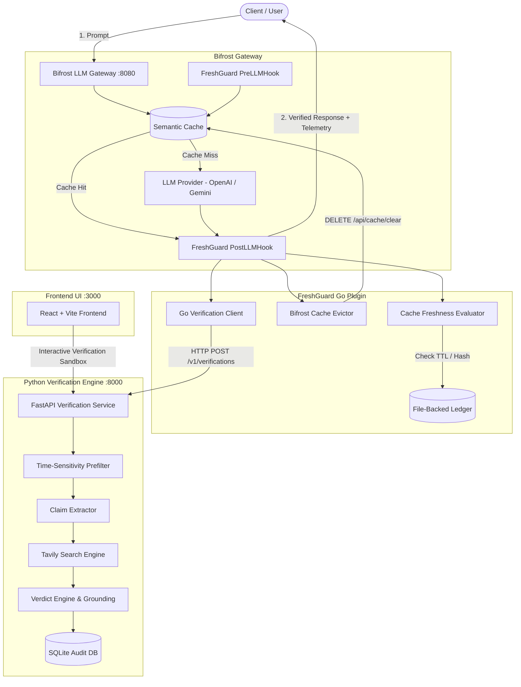

# FreshGuard

> **Trust the answer. Verify its freshness.**

[](https://github.com/kamalsolanki143/FreshGuard/actions)
[](https://golang.org)
[](https://www.python.org/)
[](LICENSE)

FreshGuard detects time-sensitive claims in LLM responses, verifies them against real-time web evidence (powered by Tavily Search and LLM reasoning), and safeguards **Bifrost semantic caching** against silently reusing stale or contradicted model answers.

---

## 🎯 Initial MVP Scope

FreshGuard focuses on high-impact, fast-moving claim categories where LLM hallucinations or stale cache entries cause severe real-world problems:

1. **Pricing & Plans**: e.g., subscription costs, token rates, API pricing tiers.
2. **Software & API Versions**: e.g., current stable releases, deprecation timelines.
3. **Company Leadership**: e.g., active CEOs, CTOs, executive leadership changes.

---

## 🏗️ System Architecture



---

## 🛡️ Core Freshness & Cache Protection Rules

1. **Missing Metadata is Never Fresh**: If a semantic cache hit occurs and no FreshGuard verification record exists, it is treated as unverified and evicted.
2. **Deterministic Expiration**: Cache TTL is strictly bound to the most volatile verified claim (`min(TTL)` across all claims).
3. **No Stale Verdict Inheritance**: A cache hit cannot silently retain an expired `SUPPORTED` verdict. Expired cache hits trigger automatic Bifrost cache eviction and optional re-verification.
4. **Contradicted Eviction**: If any claim is contradicted by newly retrieved evidence, the cache entry is immediately purged from Bifrost.
5. **Auditable Telemetry**: All responses include detailed verification metadata in `resp.ExtraFields["freshguard"]`:
   - `status`: `verified`, `cached_fresh`, `reverified`, `stale_cache_hit`, or `unverified`
   - `is_fresh`: Boolean indicating verified validity
   - `cache_evicted`: Boolean indicating whether Bifrost cache entry was invalidated
   - `claims`: Array of evaluated claims with verdicts, confidence scores, and citation sources.

---

## 🚀 Quickstart & Development

### Prerequisites

- **Python** 3.10+
- **Go** 1.21+
- **Node.js** 18+ and `npm`
- *(Optional)* **Bifrost Gateway** binary (v2.5.1+)

### 1. Automated Dev Stack Runner

Run all subsystems together with one command:

```bash
# Using Python runner (cross-platform)
python scripts/run_dev.py

# Or using PowerShell on Windows
./scripts/run_dev.ps1
```

The runner starts:
- **Verification Service**: [http://127.0.0.1:8000](http://127.0.0.1:8000) (Swagger Docs: [http://127.0.0.1:8000/docs](http://127.0.0.1:8000/docs))
- **Frontend Sandbox**: [http://localhost:3000](http://localhost:3000)

### 2. Manual Subsystem Startup

#### Python Verification Service

```bash
cd verification-service
pip install -r requirements.txt
uvicorn app.main:app --host 127.0.0.1 --port 8000
```

#### Frontend Dashboard & Sandbox

```bash
cd frontend
npm install
npm run dev
```

#### Go Plugin Test Suite

```bash
cd plugin
go test -v -count=1 ./...
```

---

## 🧪 Testing & Verification

### Run Python Test Suite (248 tests)

```bash
cd verification-service
pytest tests/ -v
```

### Run Go Plugin Test Suite (26 tests including live service integration)

```bash
cd plugin
go test -v -count=1 ./...
```

### Run Frontend Production Build

```bash
cd frontend
npm run build
```

### Test via Interactive Demonstration CLI

```bash
# Run CLI test against running verification service
python examples/demo_verify.py --text "Python 3.12 was released and ChatGPT Plus costs $20/month."
```

---

## 🔒 Security & Authentication

The verification service implements multi-tier authentication via the `X-API-Key` header:

| `API_AUTH_MODE` | Description | Target Environment |
|---|---|---|
| `disabled` | No authentication required | Local development |
| `warn` | Logs missing/invalid key without blocking | Integration testing |
| `enforce` | Strict 401 Unauthorized rejection on missing or invalid key | Staging & Production |

Configure keys via environment variables:
```bash
export API_AUTH_MODE=enforce
export VERIFICATION_SERVICE_API_KEY=your-secure-shared-secret
```

The Go plugin seamlessly passes `cfg.APIKey` and handles transient network errors with bounded exponential backoff retries and configurable fail-open / fail-closed modes.

---

## 👥 Team & Ownership

- **Kamal Solanki** (*System Architect, Bifrost & Integration Lead*): Go plugin architecture, Bifrost lifecycle hooks, cache eviction, metadata persistence ledger, and end-to-end integration.
- **Ayush** (*AI Backend Lead*): Python verification engine, claim extraction, Tavily evidence retrieval, and verdict calculation.
- **Krrish** (*Frontend Lead*): React dashboard, UI components, visualizations, and interactive verification sandbox.

---

## 📄 License

MIT © 2026 FreshGuard Contributors
